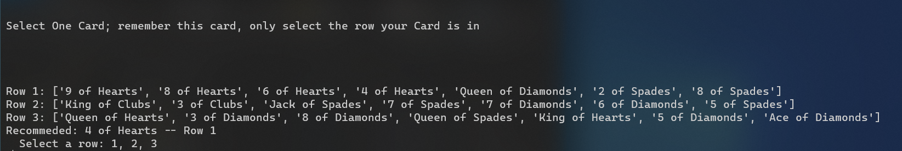
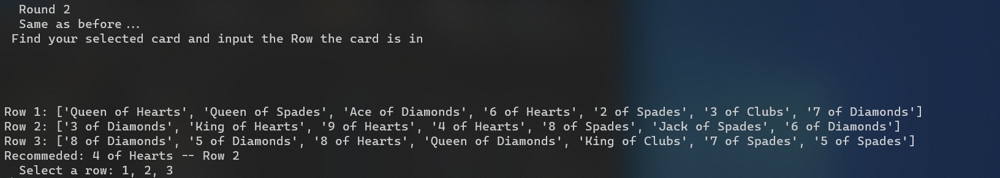
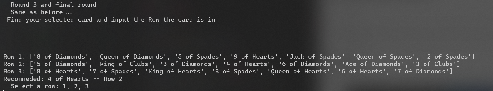

# pyHocusPocus

The classic 21-card trick, as a Python terminal program and an animated browser game.

**[▶ Play in your browser](https://dascondor.github.io/pyHocuspocus/)**

## How the trick works

Deal 21 cards into three piles of seven. The player silently picks a card and says only which pile it is in. Collect the piles with the chosen one in the middle, deal again, and repeat.

Each round narrows down where the card can be:

| After round | Possible positions in the deck |
| :---------: | :----------------------------: |
|      1      |             8 – 14             |
|      2      |            10 – 12             |
|      3      |               11               |

After the third round the card is always the 11th in the deck. It is deduction, not a guess.

Numberphile has a great explanation: [21 Card Trick](https://youtu.be/d7dg7gVDWyg).

## Browser game

1. Memorize any one of the 21 cards. Don't click it.
2. Select **I have my card**.
3. Choose the pile that contains your card, or press **1**, **2**, or **3**.
4. Do the same for the next two deals, then watch the reveal.

It is plain HTML, CSS, and JavaScript in [`web/`](web), with no build step. To run it locally, open `web/index.html`, or serve the folder:

```powershell
py -m http.server 8000 --directory web
```

Then open <http://localhost:8000>.

Changes to `web/` on `main` are deployed to GitHub Pages automatically by [`pages.yml`](.github/workflows/pages.yml).

## Python version

Requires Python 3.

```powershell
py .\Pocus.py
```

Remember a card and enter its row number each time you are asked. The program suggests a card to follow, but any card works.






### Testing

Run one automated game, where the program picks a card and checks that the reveal matches:

```powershell
py -c "from Pocus import test_Pocus; test_Pocus()"
```

The output is `picked card, revealed card, Pass/Fail, final position`.
