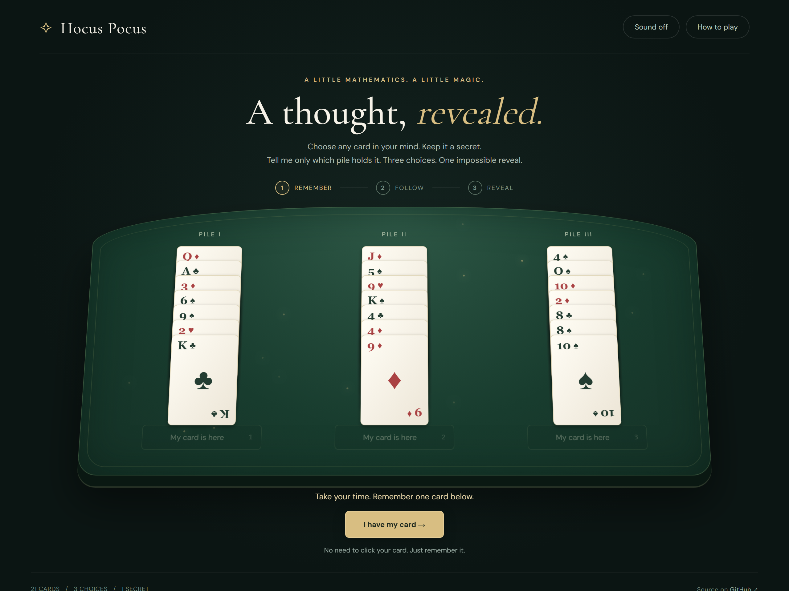

<div align="center">

# ✧ pyHocusPocus

**The classic 21-card trick — a little mathematics, a little magic.**

Think of a card. Point to its pile three times. Watch it appear.

[](https://dascondor.github.io/pyHocuspocus/)

[](https://github.com/DasCondor/pyHocuspocus/actions/workflows/pages.yml)


<a href="https://dascondor.github.io/pyHocuspocus/">
  
</a>

</div>

## Contents

- [How the trick works](#how-the-trick-works)
- [Browser game](#-browser-game)
- [Python version](#-python-version)
- [Project layout](#project-layout)

## How the trick works

Deal 21 cards into three piles of seven. The player silently picks a card and says only which pile it is in. Pick the piles back up **with the chosen pile in the middle**, deal again, and repeat.

Each round squeezes the card into a smaller part of the deck:

| Round | Where the card can be | Possibilities |
| :---: | :-------------------: | :-----------: |
| Start |        1 – 21         |      21       |
|   1   |        8 – 14         |       7       |
|   2   |        10 – 12        |       3       |
|   3   |        **11**         |     **1**     |

After the third round the card is always the 11th in the deck. It is deduction, not a guess.

> 📺 Numberphile has a great explanation of the maths: [21 Card Trick](https://youtu.be/d7dg7gVDWyg)

## 🌐 Browser game

**[Play it here](https://dascondor.github.io/pyHocuspocus/)** — nothing to install.

1. Memorize any one of the 21 cards. Don't click it.
2. Select **I have my card**.
3. Choose the pile that contains your card, or press <kbd>1</kbd>, <kbd>2</kbd>, or <kbd>3</kbd>.
4. Do the same for the next two deals, then watch the reveal.

It works with mouse, touch, or keyboard, and has optional sound.

<details>
<summary><b>Run it locally</b></summary>

<br>

The game is plain HTML, CSS, and JavaScript with no build step. Open `web/index.html` directly, or serve the folder:

```powershell
py -m http.server 8000 --directory web
```

Then open <http://localhost:8000>.

</details>

<details>
<summary><b>Deployment</b></summary>

<br>

Any change to `web/` on `main` is published to GitHub Pages automatically by [`pages.yml`](.github/workflows/pages.yml).

</details>

## 🐍 Python version

The original terminal version. Requires Python 3.

```powershell
py .\Pocus.py
```

Remember a card and enter its row number each time you are asked. The program suggests a card to follow, but any card works.

<details>
<summary><b>Screenshots</b></summary>

<br>

| Round 1 | Round 2 |
| :-----: | :-----: |
|  |  |

| Round 3 | Reveal |
| :-----: | :----: |
|  |  |

</details>

### Testing

Run one automated game, where the program picks a card itself and checks that the reveal matches:

```powershell
py -c "from Pocus import test_Pocus; test_Pocus()"
```

The output is `picked card, revealed card, Pass/Fail, final position`:

```text
9 of Clubs,9 of Clubs,Pass,8
```

## Project layout

```text
pyHocuspocus/
├── Pocus.py          # Terminal game and trick logic
├── Deck.py           # Card and deck helpers
├── test-pocus.ps1    # PowerShell test runner
├── media/            # Screenshots
└── web/              # Browser game
    ├── index.html
    ├── styles.css
    └── game.js
```
